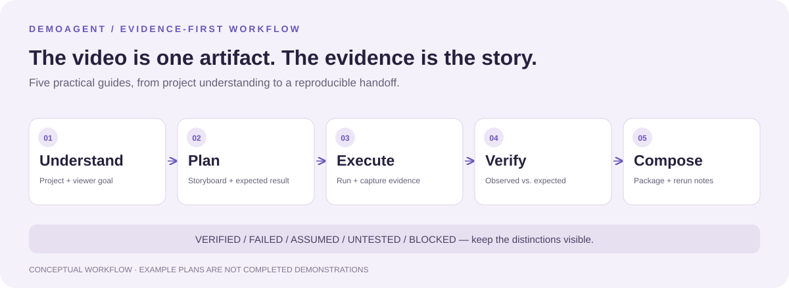

<div align="center">

# DemoAgent

### Don't just record a demo. Leave evidence someone can rerun.

A documentation-first agent skill for turning software projects into clear, reproducible demo packages.

**Markdown-based · No runtime dependencies · Evidence before claims**

[Start with the skill](SKILL.md) · [Inspect the self-demo](outputs/demoagent-self-demo/) · [Templates](templates/) · [Example plans](examples/)

</div>



A screen recording shows what happened once. A useful demo also explains what to run, which inputs to use, what actually worked, and what remains untested. DemoAgent gives an agent a practical workflow for keeping those pieces together.

> [!IMPORTANT]
> **Current evidence is limited to this skill's own structure and an external validator result.** The checked-in self-demo has not tested DemoAgent against a real React app, CLI tool, API service, or game. The example folders are plans, not completed demonstrations. This repository does not include a recorder or a runnable demo app.

## What you get

| Artifact | Question it answers |
| --- | --- |
| Demo goal | Who is this for, and what should they understand? |
| Plan / storyboard | What should happen, in which order? |
| Screenshots, recording, or logs | What was actually observed? |
| Demo trace | What commands, inputs, and steps produced the evidence? |
| Verification report | What succeeded, failed, was assumed, or remains untested? |
| README-ready summary | How can another person inspect and repeat it? |

Not every environment can produce every artifact. If recording is unavailable, the workflow calls for recording instructions and the best available evidence, with the limitation stated plainly.

## Quick start

```bash
git clone https://github.com/yuzhang-zhong/demo-agent-skill.git
cd demo-agent-skill
```

1. Read [`SKILL.md`](SKILL.md), the primary entry point.
2. Point the agent at a project and a concrete viewer goal.
3. Follow the five [`workflow/`](workflow/) guides, using the matching templates.
4. Put the result in `outputs/<project-demo-name>/`, or a suitable demo folder in the target repository.

**Example request** (a prompt, not evidence of a completed run):

> Use DemoAgent to demonstrate this project's main workflow for a first-time contributor. Inspect the setup first, plan a short walkthrough, execute it with safe test data, save the trace and evidence, and report anything that fails or remains untested.

### Make it discoverable to your agent

Copy the repository into your agent's supported skill directory, keeping `SKILL.md`, `workflow/`, and `templates/` together. For example, replace the placeholder with the actual configuration directory for your host:

```bash
cp -r demo-agent-skill <agent-config-dir>/skills/demoagent
```

Run that copy command from the parent directory of the clone. Skill loading and reload behavior depend on the host. The target project may still need dependencies, credentials, a browser, simulator, or recording tools; DemoAgent itself installs none of them.

## The workflow

| Guide | Work to do | Start from |
| --- | --- | --- |
| [01 · Understand](workflow/01_project_understanding.md) | Inspect source, setup, audience, risks, and the demo goal | [Goal template](templates/demo_goal_template.md) |
| [02 · Plan](workflow/02_demo_planning.md) | Choose a recognizable opening, key actions, and expected outcomes | [Plan template](templates/demo_plan_template.md) |
| [03 · Execute](workflow/03_demo_execution.md) | Run the flow; capture evidence and exact steps together | [Trace template](templates/demo_trace_template.md) |
| [04 · Verify](workflow/04_demo_verification.md) | Compare observations with the plan; separate all outcome states | [Verification template](templates/verification_report_template.md) |
| [05 · Compose](workflow/05_artifact_composition.md) | Package media, findings, limitations, and rerun instructions | [README template](templates/readme_demo_template.md) |

The skill expands these five guides into seven explicit activities by giving goal clarification and evidence capture their own steps. It is one workflow, not two competing sequences.

## Inspect the evidence, not a placeholder screenshot

The [self-demo package](outputs/demoagent-self-demo/README.md) shows the artifact structure in use:

- [Goal](outputs/demoagent-self-demo/demo_goal.md) and [plan](outputs/demoagent-self-demo/demo_plan.md)
- [Execution trace](outputs/demoagent-self-demo/demo_trace.md) and [run log](outputs/demoagent-self-demo/logs/demo_run.log)
- [Verification report](outputs/demoagent-self-demo/verification_report.md)

Its recorded result is **partially successful**: repository structure and skill validation were checked; there was no meaningful visual application to record. Validation used an external `quick_validate.py`, not a script bundled here. Treat the report as historical evidence of that run, not as proof of cross-project reliability or a new validation performed by reading this README.

## Pick an example plan

- [React app](examples/example_react_app_demo/README.md): a browser-facing interaction flow.
- [AI tool](examples/example_ai_tool_demo/README.md): inputs, outputs, and observable behavior.
- [Game](examples/example_game_demo/README.md): setup, player actions, and a clear outcome.

These are lightweight structures to adapt, not sample applications or verified videos.

## A package worth handing off

```text
demo/
├── README.md                  # Summary and rerun instructions
├── demo_goal.md                # Audience and takeaway
├── demo_plan.md                # Storyboard and expected outcomes
├── demo_trace.md               # Actual execution
├── verification_report.md      # Evidence and limitations
├── screenshots/                # Only if actually captured
├── recordings/                 # Or explicit recording instructions
└── logs/                       # Redacted, relevant output
```

Keep exact commands, required environment variable names, ports, fixture inputs, and setup assumptions. Never include real secrets or private data in published artifacts. Label mocked data and simulated behavior. A blocked step is useful information; hiding it is not.

## Contributing and license

Read [`AGENTS.md`](AGENTS.md) before editing. Keep the repository focused on English-language skill instructions, practical workflows, reusable templates, and lightweight examples. Keep demonstrated behavior separate from aspirations.

MIT. See [LICENSE](LICENSE).
