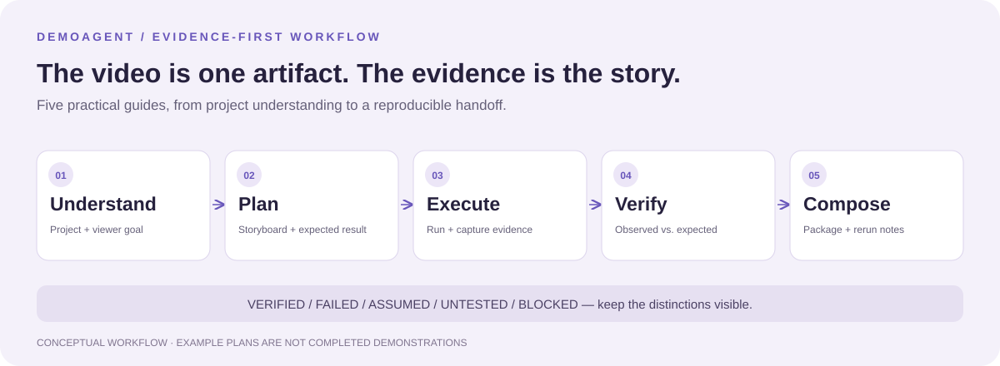

<div align="center">

# DemoAgent

**留下别人能检查、也能重新运行的演示。**

一份以文档为主的 Agent Skill，把软件项目的演示步骤、材料和复现说明放在一起。

[English](README.md) · **简体中文**

[](LICENSE)

[快速开始](#quick-start) · [Skill 入口](SKILL.md) · [查看自演示](outputs/demoagent-self-demo/) · [模板](templates/) · [示例计划](examples/)

</div>

一份演示包应记录环境、输入、实际运行过的步骤，以及尚未检查的部分。DemoAgent 将计划、证据和复现说明保留在同一个流程中。

Skill 本身由 Markdown 构成，没有运行时依赖。被演示的项目与录制工具仍需各自的环境。

> [!NOTE]
> **这是文档型 Skill。** 仓库提供流程与模板，不包含录制器或可运行的演示应用。示例是计划；现有自演示只检查了仓库结构和外部 Skill 校验。范围见[自演示与验证](#self-demo-and-verification)。

<a id="what-you-get"></a>
## 输出哪些材料

| 材料 | 回答的问题 |
| --- | --- |
| 演示目标 | 给谁看，希望对方理解什么？ |
| 计划 / 分镜 | 哪些事情应按什么顺序发生？ |
| 截图、录屏或日志 | 实际观察到了什么？ |
| 演示轨迹 | 哪些命令、输入和操作产生了证据？ |
| 验证报告 | 哪些成功、失败、属于假设，或仍未测试？ |
| README 摘要 | 其他人怎样检查并重复这个过程？ |

并非每个环境都能产出所有材料。如果无法录屏，流程要求提供录制步骤与当前能取得的证据，并明确说明限制。

<a id="quick-start"></a>
## 快速开始

```bash
git clone https://github.com/yuzhang-zhong/demo-agent-skill.git
cd demo-agent-skill
```

1. 阅读主入口 [`SKILL.md`](SKILL.md)。
2. 给 Agent 指定项目和明确的观看目标。
3. 按五份 [`workflow/`](workflow/) 指南执行，使用对应模板。
4. 将结果放入 `outputs/<project-demo-name>/`，或目标项目中合适的演示目录。

**请求示例**，不是已完成运行的证据：

> 使用 DemoAgent，向首次参与的贡献者演示这个项目的主要流程。先检查环境，安排一段简短的操作过程，用安全测试数据执行，保存轨迹和证据，并报告失败或尚未验证的部分。

<a id="make-it-discoverable-to-your-agent"></a>
### 让宿主发现这个 Skill

将仓库复制到宿主支持的技能目录，保持 `SKILL.md`、`workflow/` 和 `templates/` 在一起。下面的占位符需要替换为宿主实际配置目录：

```bash
cp -r demo-agent-skill <agent-config-dir>/skills/demoagent
```

从克隆目录的上级目录运行复制命令。加载和重新加载方式由宿主决定。目标项目可能还需要依赖、凭据、浏览器、模拟器或录制工具；DemoAgent 不会安装这些组件。

<a id="the-workflow"></a>
## 工作流程



| 指南 | 要做的事 | 对应模板 |
| --- | --- | --- |
| [01 · 理解](workflow/01_project_understanding.md) | 查看源码、环境、读者、风险和目标 | [目标模板](templates/demo_goal_template.md) |
| [02 · 计划](workflow/02_demo_planning.md) | 安排开场、主要操作和预期结果 | [计划模板](templates/demo_plan_template.md) |
| [03 · 执行](workflow/03_demo_execution.md) | 实际运行，同时记录证据与精确步骤 | [轨迹模板](templates/demo_trace_template.md) |
| [04 · 验证](workflow/04_demo_verification.md) | 对照观察与计划，区分不同结果状态 | [验证模板](templates/verification_report_template.md) |
| [05 · 整理](workflow/05_artifact_composition.md) | 打包媒体、发现、限制和复现说明 | [README 模板](templates/readme_demo_template.md) |

Skill 的七项活动沿用这五份指南，其中目标澄清与证据采集各自有单独步骤。

<a id="inspect-the-evidence-not-a-placeholder-screenshot"></a>
<a id="self-demo-and-verification"></a>
## 自演示与验证

当前证据限于 Skill 自身结构和外部校验器的结果。现有自演示没有在真实 React 应用、CLI 工具、API 服务或游戏上验证 DemoAgent。

[自演示包](outputs/demoagent-self-demo/README.md)展示了材料结构：

- [目标](outputs/demoagent-self-demo/demo_goal.md)与[计划](outputs/demoagent-self-demo/demo_plan.md)
- [执行轨迹](outputs/demoagent-self-demo/demo_trace.md)与[运行日志](outputs/demoagent-self-demo/logs/demo_run.log)
- [验证报告](outputs/demoagent-self-demo/verification_report.md)

记录中的结果为**部分成功**：检查了仓库结构和 Skill 校验，但没有可供录制的实际视觉应用。校验使用外部 `quick_validate.py`，该脚本不包含在仓库内。这是那次运行的历史证据，不证明跨项目可靠性，也不代表阅读本 README 就完成了新的验证。

<a id="pick-an-example-plan"></a>
## 选择一份示例计划

- [React 应用](examples/example_react_app_demo/README.md)：面向浏览器交互的流程。
- [AI 工具](examples/example_ai_tool_demo/README.md)：输入、输出与可观察行为。
- [游戏](examples/example_game_demo/README.md)：环境、玩家操作与明确结果。

这些是便于调整的轻量结构，不是示例应用或经过验证的视频。

<a id="a-package-worth-handing-off"></a>
<a id="demo-package-structure"></a>
## 演示包结构

```text
demo/
├── README.md                  # Summary and rerun instructions
├── demo_goal.md                # Audience and takeaway
├── demo_plan.md                # Storyboard and expected outcomes
├── demo_trace.md               # Actual execution
├── verification_report.md      # Evidence and limitations
├── screenshots/                # Only if actually captured
├── recordings/                 # Or explicit recording instructions
└── logs/                       # Redacted, relevant output
```

保留精确命令、所需环境变量名、端口、测试输入和环境假设。公开材料不得包含真实密钥或私人数据。模拟数据与模拟行为要明确标注，受阻步骤也应如实记录。

<a id="contributing-and-license"></a>
## 贡献与许可

修改前阅读 [`AGENTS.md`](AGENTS.md)。仓库专注于英文 Skill 说明、实用流程、可复用模板与轻量示例；请区分已经展示的行为和计划中的能力。

MIT，详见 [LICENSE](LICENSE)。
